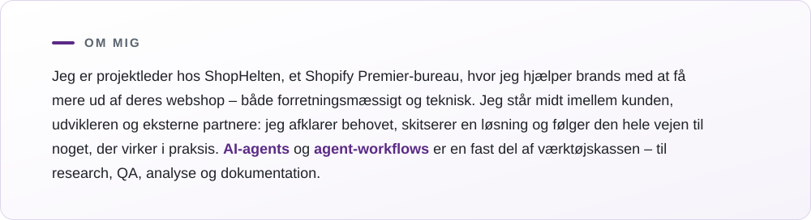
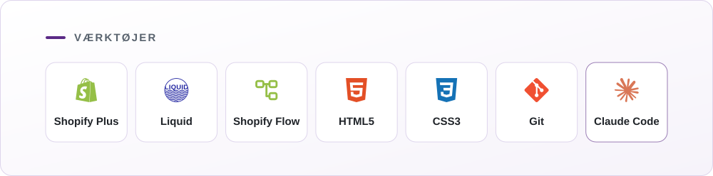
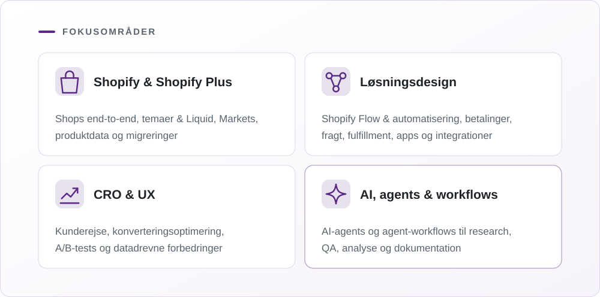
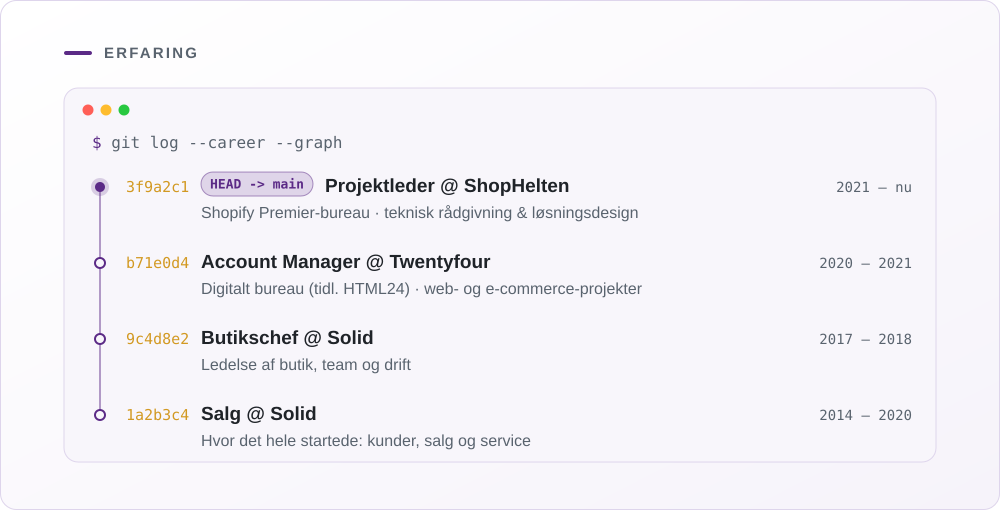
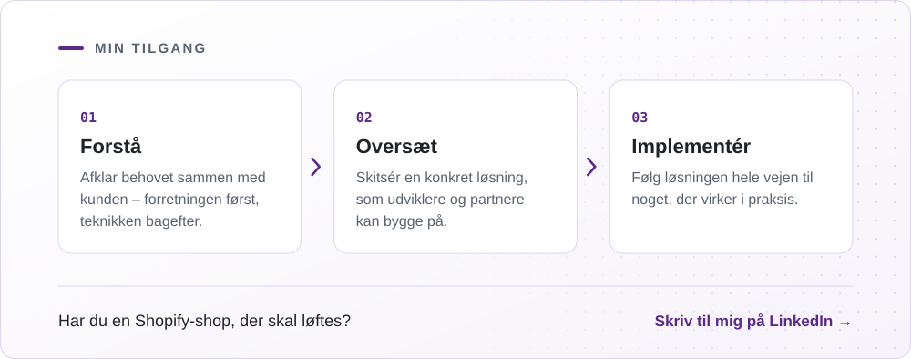

<a href="https://www.linkedin.com/in/mathiast%C3%B8pfer/">
<picture>
  <source media="(prefers-color-scheme: dark)" srcset="assets/banner-dark-p.svg">
  
</picture>

</a>

<picture>
  <source media="(prefers-color-scheme: dark)" srcset="assets/about-dark-p.svg">
  
</picture>

<picture>
  <source media="(prefers-color-scheme: dark)" srcset="assets/tools-dark-p.svg">
  
</picture>

<picture>
  <source media="(prefers-color-scheme: dark)" srcset="assets/focus-dark-p.svg">
  
</picture>

<picture>
  <source media="(prefers-color-scheme: dark)" srcset="assets/experience-dark-p.svg">
  
</picture>

<picture>
  <source media="(prefers-color-scheme: dark)" srcset="assets/activity-dark-p.svg">
  
</picture>

<a href="https://www.linkedin.com/in/mathiast%C3%B8pfer/">
<picture>
  <source media="(prefers-color-scheme: dark)" srcset="assets/approach-dark-p.svg">
  
</picture>
</a>
