<picture>
  <source media="(prefers-color-scheme: dark)" srcset="assets/banner-dark.svg">
  
</picture>

  
  

 

Jeg hjælper brands med at få mere ud af deres **Shopify-webshop** – både forretningsmæssigt og teknisk.
Som bindeled mellem kunde, udvikling og eksterne partnere afklarer jeg behovet, designer løsningen og følger den hele vejen til noget, der virker i praksis.

 

## Fokusområder

<table>
  <tr>
    <td width="50%" valign="top">
      <h3>🛍️ Shopify &amp; Shopify Plus</h3>
      Shops end-to-end · temaer &amp; Liquid · Markets · produktdata, struktur og migreringer
    </td>
    <td width="50%" valign="top">
      <h3>🧩 Løsningsdesign</h3>
      Shopify Flow &amp; automatisering · betalinger, fragt &amp; fulfillment · apps og integrationer
    </td>
  </tr>
  <tr>
    <td width="50%" valign="top">
      <h3>📈 CRO &amp; UX</h3>
      Kunderejse · konverteringsoptimering · A/B-tests og datadrevne forbedringer
    </td>
    <td width="50%" valign="top">
      <h3>🤖 AI i workflowet</h3>
      Research, QA, analyse og dokumentation – AI som værktøj, ikke erstatning for håndværket
    </td>
  </tr>
</table>

## Erfaring

| | Rolle | Virksomhed |
|:--|:--|:--|
| **2021 – nu** | Projektleder | **ShopHelten** · Shopify Premier-bureau |
| 2020 – 2021 | Account Manager | Twentyfour (tidl. HTML24) |
| 2014 – 2020 | Salg &amp; butikschef | Solid |

## Værktøjer

  
  
  
  
  
  
  

 

> **Min tilgang** — forstå problemet, oversæt det til en konkret løsning, og få det implementeret sammen med de rigtige folk.

Har du en Shopify-shop, der skal løftes? Skriv til mig på <a href="https://www.linkedin.com/in/mathiast%C3%B8pfer/">LinkedIn</a>.

